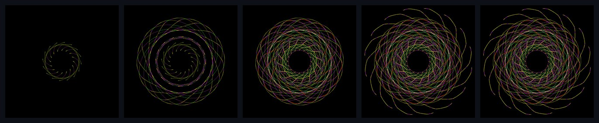

# MandalaCreator

A mandala drawn one line at a time in Processing, where the figure emerges from
two parameters slowly drifting apart.

The sketch rotates by `2 * PI / pow(2, order)` each step, with `order = 4`, so
sixteen copies of every stroke land around the circle. Two parameters, `a` and
`b`, control the shape. They start close together at 2.5 and 2.4, and `b`
decrements by 0.01 every frame, so the ratio between them drifts and the figure
opens out rather than closing on itself.

That drift is the whole design. A fixed ratio gives one static rosette. A moving
one gives the sequence above, and the frames in `mandala/GifPhotos/` are one run
sampled every twenty frames.

Colour cycles through a five-colour palette as the iteration counter advances.

| File | |
|---|---|
| `mandala/mandala.pde` | The 2D sketch. |
| `mandala/mandala3D.pde` | The same construction in three dimensions, commented line by line. |

## Run

1. Install [Processing](https://processing.org/download/).
2. Open `mandala/mandala.pde`.
3. Press run.

Canvas is 1400 by 1400. Change `order` for a different number of symmetries and
`incrVal` for how fast the figure opens.
